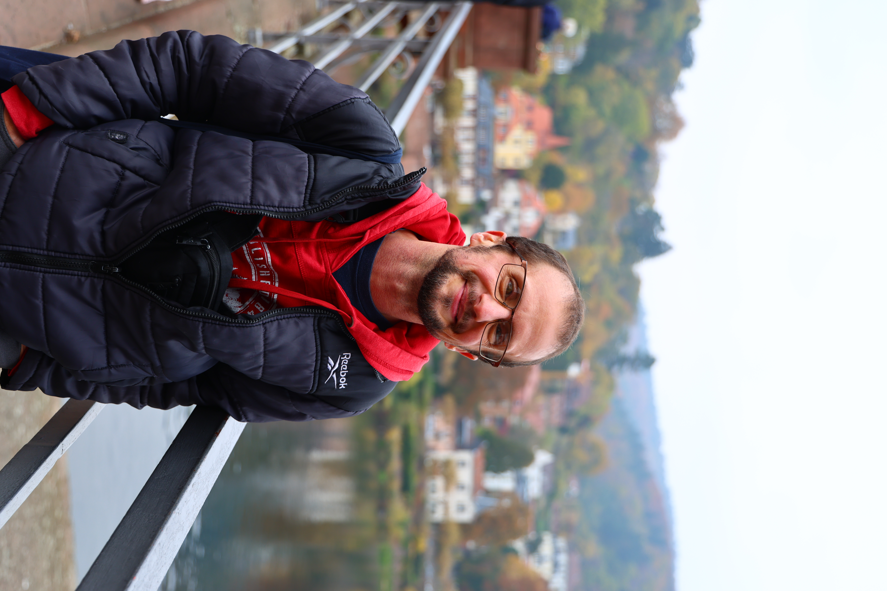

[[resume]](https://nayp3.github.io/resume)  [[CV]](https://nayp3.github.io/CV)  [[projects]](https://nayp3.github.io/portfolio)

### Hi. Thanks for stopping by.

<!--I like being surrounded by chickens on a farm  
I like that feeling of being on the Manhattan bridge, at night, and *Empire State of Mind* comes on  
I like being a little lost in the woods, but not too much  
I like -->
My primary professional interest is to use data to uncover patterns humans can't see. I am interested in projects that advance methodological approaches and contribute to a greater good, with a particular interest in machine learning methods in text analysis, especiially for evaluating outcomes of policies and processes.

<!--

   

-->

<h3>
<i>This page is a work in progress. Please stay tuned for updates!</i>
</h3>

Please check out my [resume](https://nayp3.github.io/resume), my long-form [CV](https://nayp3.github.io/CV) and a visual walkthrough of some of my experiences on my [projects](https://nayp3.github.io/portfolio) page (more to come). 

I'd welcome requests to connect over coffee or Zoom. You can connect with me on [LinkedIn](https://www.linkedin.com/in/naypetrucelli/) or complete the form below (coming soon). 
